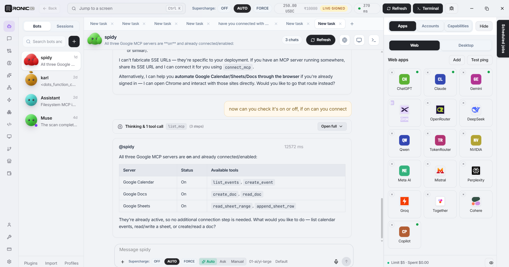
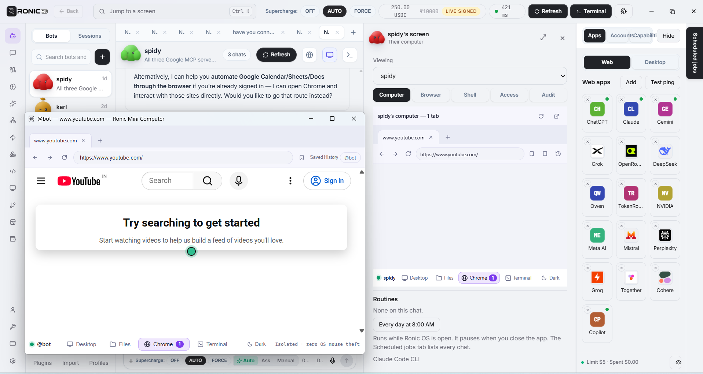
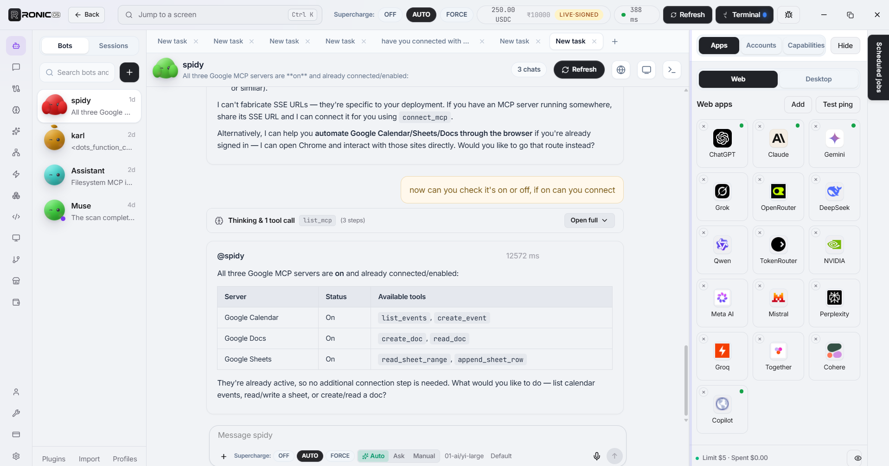
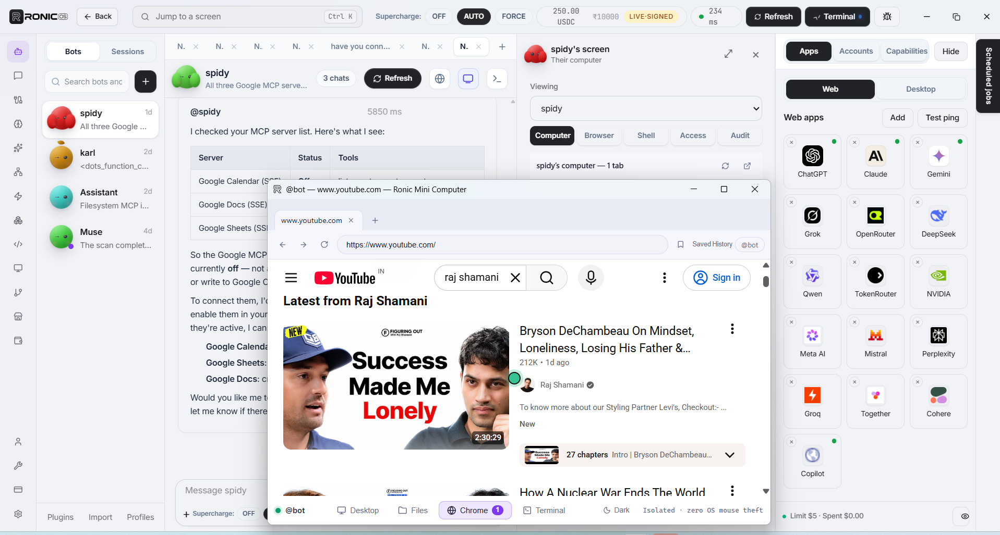
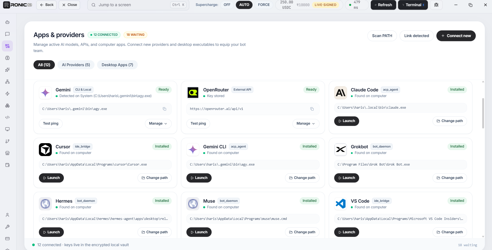
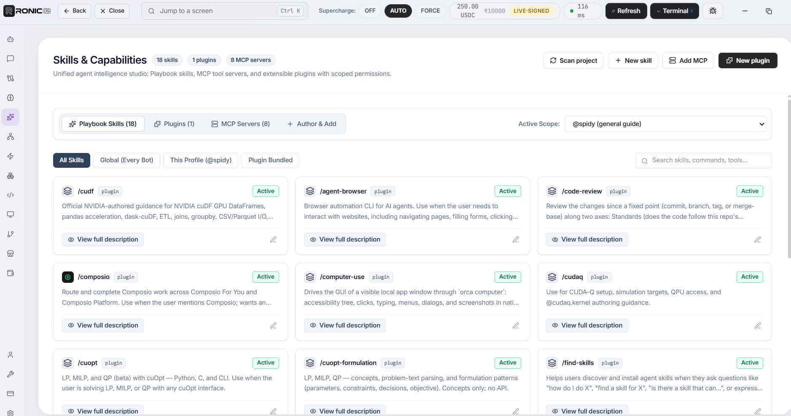
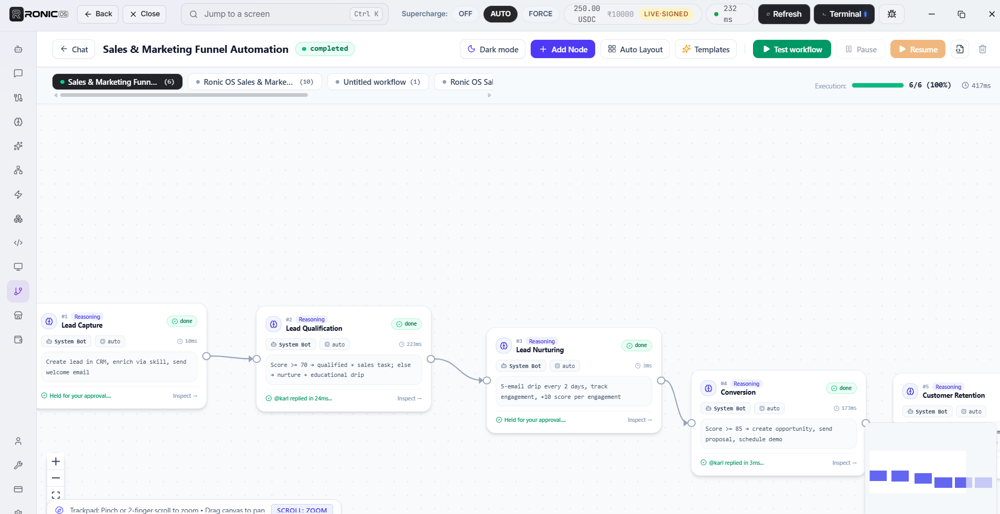
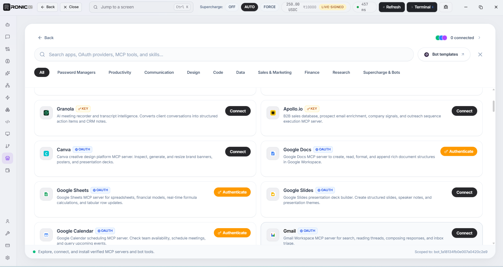
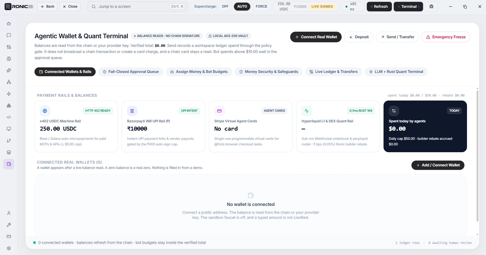
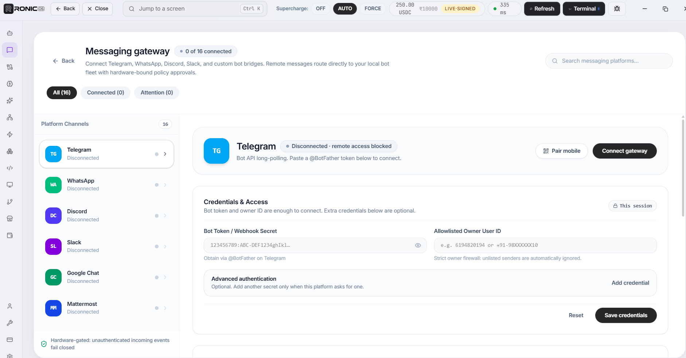

# Ronic OS 

A local-first agent workstation for Windows. One desktop shell where coding
CLIs, web agents, MCP servers, bot profiles, memory, skills, workflows, and a
sandbox wallet share a single workspace — with no server-side dependency for
the core loop.

## Screenshots

These are the running desktop app.

Chat, with bots and the web apps dock.



A bot's computer, with a site open beside the chat.



<details>
<summary><mark>View screenshots</mark></summary>

The same chat, with each web app's own icon.



A site window opened from the bot computer.



Apps and providers already found on this computer.



Skills, plugins, and MCP servers.



A workflow on the canvas.



Connect apps, OAuth providers, and MCP tools.



Wallet and quant terminal. Balances stay on this computer.



Messaging gateway.



</details>

- **Frontend:** React 19 + TypeScript + Vite 7 + Tailwind 4 + Zustand
- **Desktop shell:** Tauri 2 (WebView2), Rust backend (~23k lines)
- **State:** SQLite (`state.db` under `~/.omniworkspace`) + encrypted vault
  (Argon2id passphrases, AES-256-GCM secrets)

## What is in the box

| Screen | What it does |
| --- | --- |
| Bots & groups | Chat with local bot profiles, group chats, model routing, failover |
| Apps & providers | Detect and link CLIs, IDEs, web agents; store API keys in the vault |
| Memory | Local Mem0-style vault, graph edges, Obsidian export |
| Skills & Capabilities | SKILL.md playbooks, MCP servers, plugins, project plugins |
| MCP & ACP mesh | Local MCP bridge (127.0.0.1), harness registration, cloudflared tunnel |
| Bot fleet | Daemon control, routines, fleet log |
| Coding agents | Coding workspace with embedded terminal, git status |
| Computer & browser | URL inspector and allowlisted sandbox commands |
| Workflows | Multi-step bot runs with approval gates and checkpoints |
| Marketplace | Catalog installs (MCP-backed items register the real server) |
| Wallet & trading | Sandbox ledger with policy gates (live rails are off in this build) |
| Self-modify / Self-repair | Local extensions and a doctor that repairs the workspace |

## Commands

```bash
npm install            # once
npm run desktop        # dev: vite + tauri window (handles stale ports/orphans)
npm run desktop:build  # release build (syncs omniworkspace.exe to the repo root)
npm run typecheck      # tsc --noEmit
npm test               # desktop.mjs unit tests (node:test)
npm run test:rust      # Rust unit tests (embeds the comctl6 manifest on Windows)
```

## Build notes (Windows, GNU toolchain)

- The project builds with the **x86_64-pc-windows-gnu** toolchain. `windres`
  cannot preprocess paths that contain spaces, so the build scripts redirect
  `CARGO_TARGET_DIR` to `%LOCALAPPDATA%\omniworkspace-target`. **Run builds
  through `npm run desktop…`, not bare `cargo build`, or a space in the repo
  path will break the resource compile.**
- `npm run test:rust` needs `mt.exe` from the Windows SDK to embed the
  Common-Controls v6 manifest into the test binary.
- The Rust lib is built `rlib`-only: the MinGW linker rejects a cdylib once
  Rust's export ordinals pass 65535.

## Security model (short version)

- Secrets live in `~/.omniworkspace/secrets.vault` (AES-256-GCM; key derived
  with Argon2id from your passphrase). `lock_vault` drops the key from memory.
- The main window's Tauri capabilities are scoped to `windows: ["main"]` —
  webviews that host third-party sites get no IPC.
- The MCP bridge listens on 127.0.0.1 only and answers a fixed tool whitelist;
  the public tunnel (cloudflared) is opt-in.
- Bug reports strip API keys before they are saved anywhere.

## Repo layout

```
src/            React app (screens, components, kernel glue, browser preview)
src-tauri/      Rust backend (commands, agent loop, bridge, fleet, vault, licensing)
backend/        Vercel control plane (billing webhooks, burst proxy, PKCE bounce)
supabase/       schema.sql + license-lease Edge Function (Ed25519 signer)
scripts/        desktop dev/build orchestration + test runners
```

## Cloud licensing (summary)

The desktop verifies Ed25519-signed 7-day leases offline — see
[`backend/README.md`](backend/README.md) for the deploy/secrets checklist and
`supabase/schema.sql` for the tables. Release builds compile in
`RONIC_ED25519_PUBLIC_KEY`; without it the app runs in unsigned dev mode
(license shown, never enforced) and every local feature keeps working.

